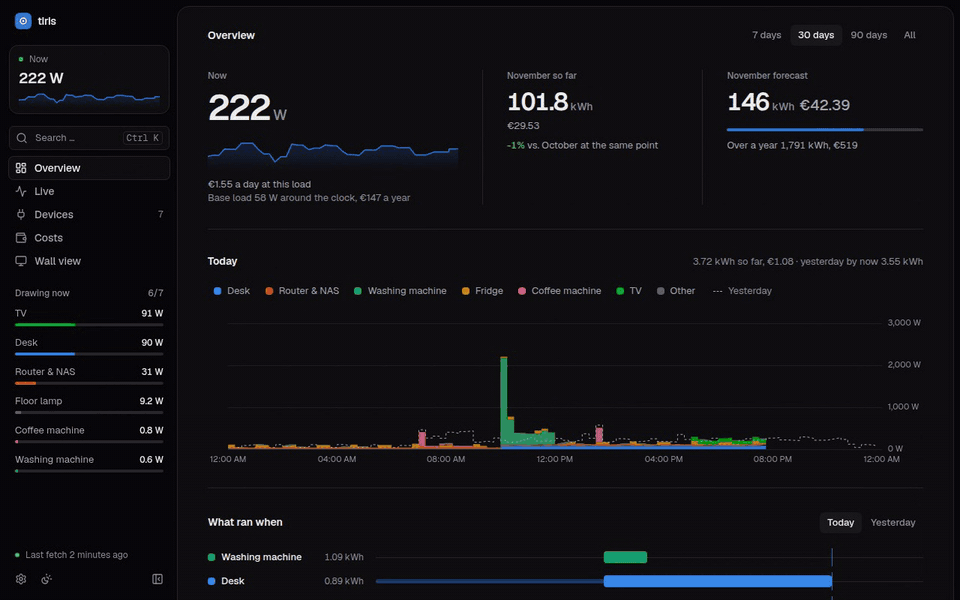
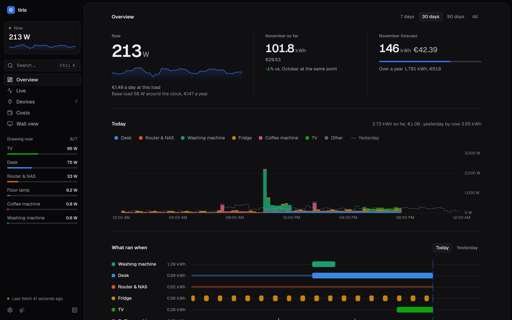
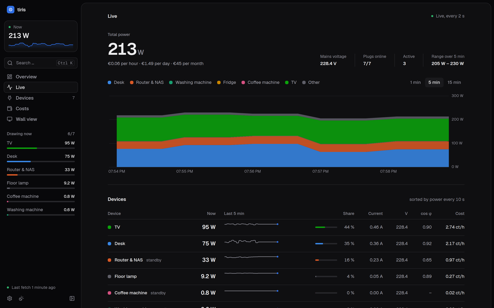
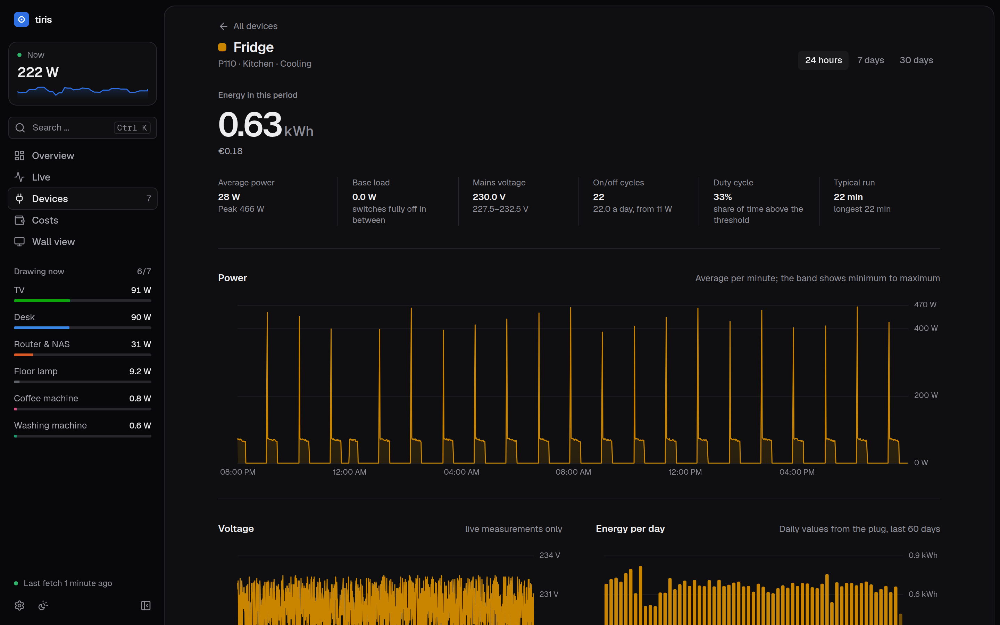
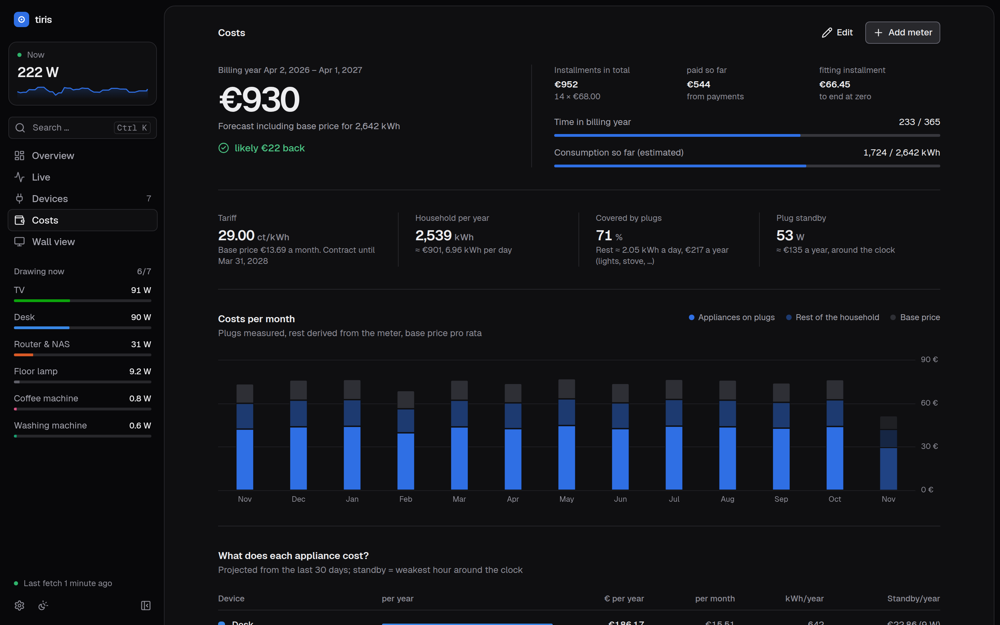
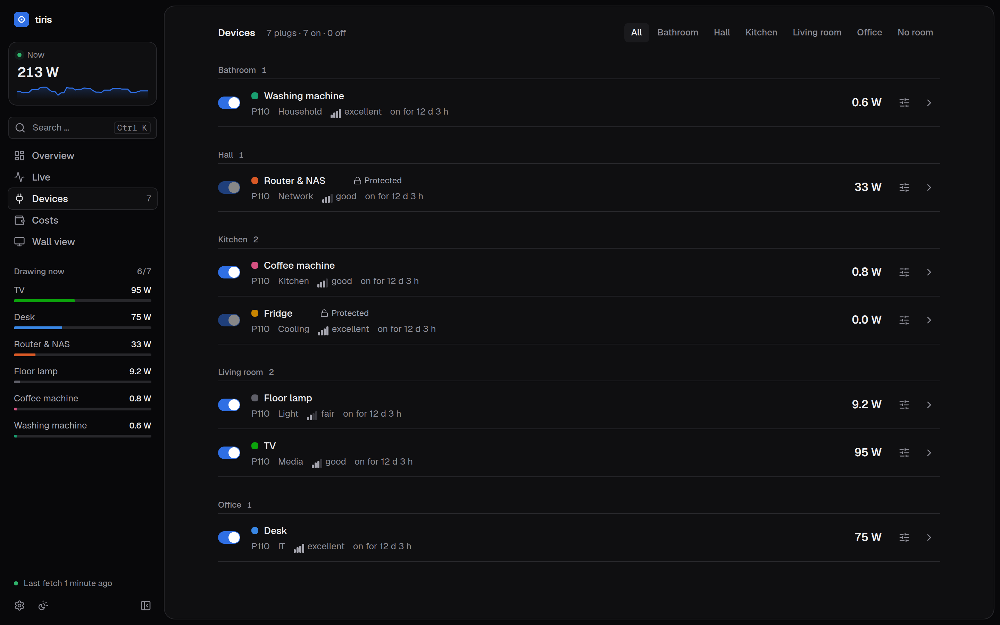
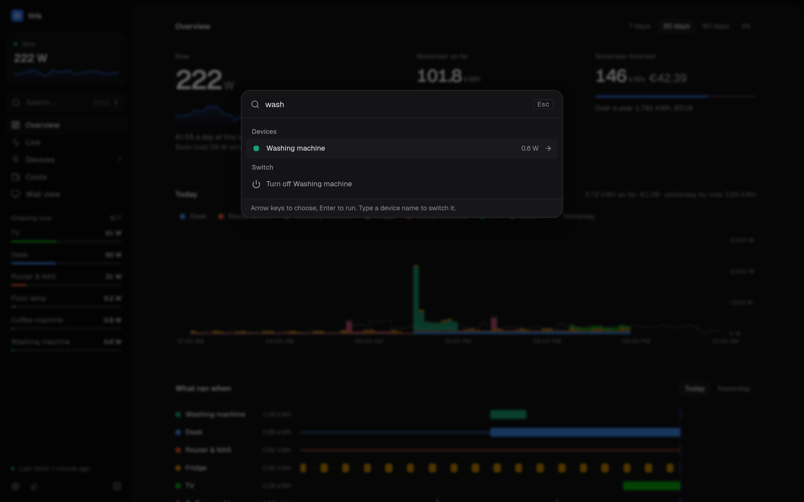
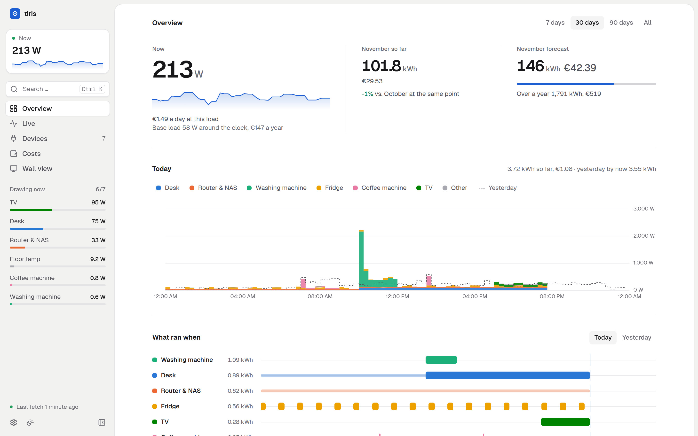
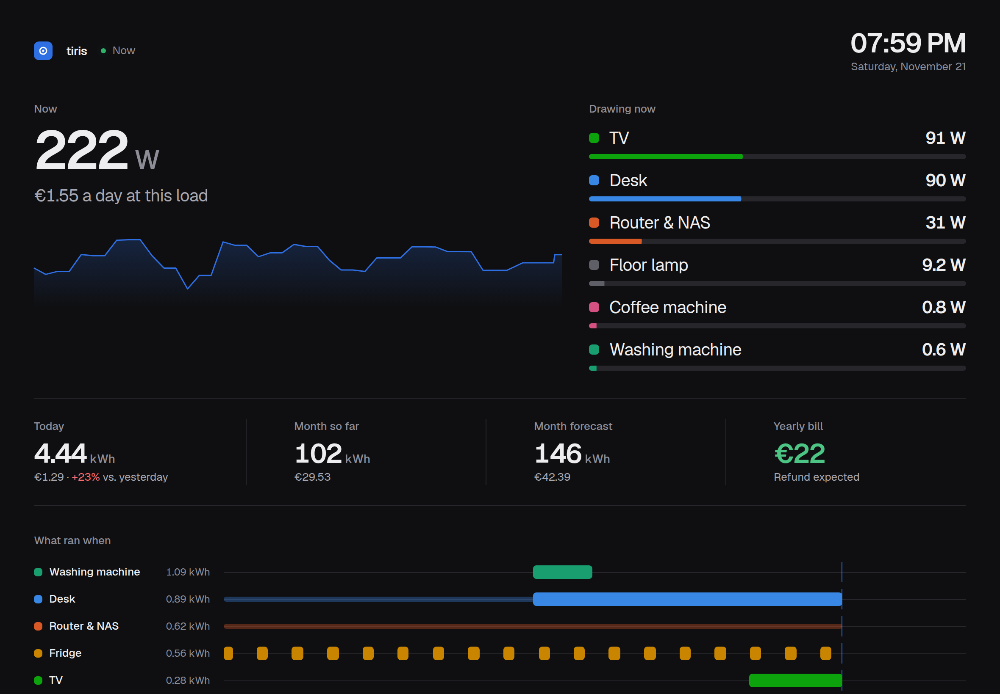

# tiris

Local-first energy monitor for TP-Link Tapo smart plugs: history, live power, device control and costs, in one
small app for your home lab.



- **History**: hourly, daily and monthly energy as far back as each plug keeps it, checked before it is stored.
- **Live**: power, voltage, current and power factor every 2 seconds, stacked per device, stored and aggregated
  in TimescaleDB.
- **What ran when**: a timeline per device for today or yesterday, and the biggest runs with duration and cost.
- **Analysis**: per device the power curve, voltage, on/off cycles, duty cycle, typical run time, typical day,
  week profile and months.
- **Devices**: rename, switch, timers, restart, firmware updates, rooms and categories, and a protection that
  keeps a fridge from being switched off by accident.
- **Costs**: meters for electricity and gas, tariffs and installment plans with validity periods, meter
  readings, payments, cost per device and month, and a forecast of the yearly bill.
- **Wall view**: a full-screen page for a tablet that stays on for weeks.
- **Command palette** (Ctrl/Cmd+K): jump to any page or device, switch devices, fetch now.

Everything stays in your network. tiris talks to the plugs directly; the Tapo account is only used for the
plug's local handshake. No cloud calls, no telemetry. English and German UI, light and dark.

Supported: P110, P110M, P115, and the sockets of P304M / P316M (anything the
[`tapo`](https://github.com/mihai-dinculescu/tapo) library supports with energy monitoring).

## Try it without plugs

The demo mode makes up seven devices with 14 months of history and live values:

```bash
git clone https://github.com/Rene-Roscher/tiris.git && cd tiris
docker compose -f docker-compose.demo.yml up
```

Open `http://localhost:8080` (another port: `TIRIS_HTTP_PORT=8095 docker compose -f docker-compose.demo.yml up`).

## Quick start

Requirements: Docker on a Linux machine in the same network as the plugs (a Raspberry Pi 4/5 is enough).
Discovery uses UDP broadcasts, so the app runs with host networking, which Docker Desktop on macOS and Windows
does not offer.

```bash
git clone https://github.com/Rene-Roscher/tiris.git && cd tiris
cp .env.example .env        # your Tapo account and your subnet broadcast, e.g. 192.168.1.255
docker compose up -d
```

Open port 8080 of that machine, e.g. `http://raspberrypi.local:8080`. The first fetch runs at start and reads as much history as the plugs keep; live values
appear within seconds. Then add your electricity meter, tariff and a meter reading under **Costs**.

Both compose files use the prebuilt image `ghcr.io/rene-roscher/tiris` (amd64 and arm64, published for every
release); they build from the checkout only if the image cannot be pulled, or with `docker compose up --build`.
A fixed version: `TIRIS_VERSION=0.1.0 docker compose up -d`.

## Screenshots

| | |
|---|---|
|  |  |
|  |  |
|  |  |
|  |  |

All screenshots come from the demo mode.

## How it works

| Source on the plug | Resolution | The plug keeps | tiris |
|---|---|---|---|
| live meter (`get_energy_meter_data`) | power, voltage, current, energy counter | now | polled every 2 s; energy from the counter, so it is exact whatever the poll rate |
| 5-minute power buffer | 5 min | about 10 days | read every 15 min; fills gaps when tiris was down |
| hourly energy | 1 h | about 8 days (busy plugs) to 30 days | read every 15 min |
| daily energy | 1 day | about 3 months (busy) to 8 months | read every 15 min |
| monthly energy | 1 month | 13 to 22 months | read every 15 min |

Values measured on P110 plugs with firmware 1.4.7 and 1.4.8. Plugs keep a number of entries rather than a time
span, so rarely used plugs reach further back. "All" in the overview therefore starts at the first month for
which most plugs still have values, and names the sparse months before it.

What tiris checks before storing history:

- **Cross-level validation.** Each daily window is checked against the monthly values, each hourly window
  against the daily values. On real plugs, daily windows older than a year came back shifted by about a month;
  such windows are dropped.
- **Replay guard.** An older window that repeats a newer one is dropped.
- **Never shrink.** Values are upserted with `GREATEST`, so a plug reset or "delete energy data" in the app does
  not erase stored history.
- **Zeros only where certain.** Beyond its memory a plug returns 0 instead of "unknown"; tiris stores zeros only
  inside the part the plug surely still holds.
- **One poller per database.** A second tiris process on the same database waits instead of polling: it would
  count energy twice and evict the first one's plug sessions.

Storage: raw samples are compressed after a day and kept for `TIRIS_RAW_RETENTION_DAYS` (365 by default);
minute, 15-minute and hourly aggregates are kept forever. 20 plugs produce about 1.15 million raw rows a day,
a few GB a year after compression (estimate).

## Wall view (tablet)

Open `/wall` on a tablet or a spare screen. It shows the current power with the last minutes, who draws how much,
today, the month, the forecast, the yearly bill and what ran today, in sizes readable from across a room. It is
made to stay open: it keeps the screen awake (Screen Wake Lock, needs HTTPS or localhost in most browsers),
moves its content by up to 2 px once a minute against burn-in, reloads itself at 04:00, and hides the controls
and the cursor after a few seconds. A 7-minute soak test showed a flat memory curve (about 5 MB of JS heap).

## Configuration

All settings are environment variables (`.env`). Plugs, meters, tariffs and the rest are set up in the UI.

| Variable | Default | Meaning |
|---|---|---|
| `TIRIS_TAPO_USERNAME`, `TIRIS_TAPO_PASSWORD` | – | the Tapo account the plugs are bound to |
| `TIRIS_DISCOVERY_TARGETS` | `255.255.255.255` | subnet broadcast and/or fixed plug IPs, comma separated |
| `TIRIS_PASSWORD` | empty | password for the UI; empty means no login |
| `TIRIS_TIMEZONE` | `Europe/Berlin` | day boundaries and schedules |
| `TIRIS_LIVE_INTERVAL_S` | `2` | live poll interval; plugs update their power value about every 1.5 s |
| `TIRIS_COLLECT_INTERVAL_MIN` | `15` | history fetch interval |
| `TIRIS_RAW_RETENTION_DAYS` | `365` | how long raw 2-second samples are kept |
| `TIRIS_PORT` | `8080` | HTTP port |
| `TIRIS_DEMO` | `false` | made-up devices and history instead of real plugs (for trying it out) |

## Running it somewhere else (VPS, cloud)

tiris has to reach the plugs on your home network: it talks to each plug's local API and finds them by UDP
broadcast. A server at a hosting provider cannot see your LAN, so on its own it cannot track anything. It works
through a VPN:

1. Connect the server to your home network with WireGuard or Tailscale (a router with WireGuard, or a small
   always-on device at home as subnet router).
2. Give the plugs fixed addresses (DHCP reservations in the router) and list them in `TIRIS_DISCOVERY_TARGETS`,
   e.g. `192.168.1.40,192.168.1.41`. Broadcasts do not cross the tunnel; unicast discovery does.
3. Set `TIRIS_PASSWORD` and put tiris behind a reverse proxy with HTTPS. Do not expose port 8080 directly; the
   server then also holds your Tapo account credentials.

What to expect: live polling is ten small requests every 2 s, a few kB/s; round trips of 20 to 40 ms over the
tunnel are fine. When the tunnel drops, live samples are missing for that time, but history is not lost: each
plug keeps about 10 days of 5-minute power and its hourly, daily and monthly energy, and tiris backfills them
on the next fetch. Running tiris at home and only viewing it remotely (through the same VPN) is simpler and
keeps the credentials at home.

## Security

tiris is made for a trusted home network. It binds to all interfaces of the host; put it behind your reverse
proxy for anything else. With `TIRIS_PASSWORD` set, the UI and API require a login (HttpOnly, SameSite=Strict
session cookie). Device actions that cut power (switch off, restart, firmware update) ask for confirmation, and
protected devices refuse them on the server. Factory reset is not offered.

## Development

```bash
# backend (Python 3.12, uv)
cd backend && uv sync
TIRIS_DATABASE_URL=postgresql://... uv run python -c "from tiris.main import run; run()"
TIRIS_DEMO=true TIRIS_DATABASE_URL=postgresql://.../empty_db uv run python -c "from tiris.main import run; run()"
TIRIS_TEST_DATABASE_URL=postgresql://.../empty_db uv run pytest   # drops that database's schema

# web (Node 22, pnpm)
cd web && pnpm install && pnpm dev        # proxies /api to TIRIS_API (default http://127.0.0.1:8080)
```

Design decisions are in [docs/PLAN.md](docs/PLAN.md).

## How it was built

tiris was built agentically: Rene Roscher steered and reviewed, [Claude Code](https://claude.com/claude-code)
(Claude Opus) designed, wrote, tested and measured it, in roughly two to three hours of sessions. The decisions
are in [docs/PLAN.md](docs/PLAN.md), the reasons for each change in the commit messages. Numbers in this README
(plug memory, soak test, motion) were measured, not estimated, unless they say so.

## Credits

tiris stands on these projects:

- [**tapo**](https://github.com/mihai-dinculescu/tapo) by Mihai Dinculescu (MIT): the Rust/Python library that
  speaks the plugs' local protocol, including the newer TPAP handshake. Without it there would be no tiris.
- [**TimescaleDB**](https://github.com/timescale/timescaledb) on PostgreSQL: hypertables, compression and
  continuous aggregates. Compression and continuous aggregates are under the Timescale License (free to self-host;
  the `timescale/timescaledb` image includes them).
- Backend: [FastAPI](https://fastapi.tiangolo.com) (MIT), [Uvicorn](https://www.uvicorn.org) (BSD-3-Clause),
  [psycopg 3](https://www.psycopg.org) (LGPL-3.0), [pydantic-settings](https://github.com/pydantic/pydantic-settings) (MIT).
- Web UI: [Vue](https://vuejs.org), [Vite](https://vite.dev), [Tailwind CSS](https://tailwindcss.com),
  [shadcn-vue](https://www.shadcn-vue.com) on [Reka UI](https://reka-ui.com), [TanStack Query](https://tanstack.com/query),
  [VueUse](https://vueuse.org), [vue-i18n](https://vue-i18n.intlify.dev), [vue-sonner](https://github.com/xiaoluoboding/vue-sonner),
  [vue-echarts](https://github.com/ecomfe/vue-echarts) (all MIT), [Apache ECharts](https://echarts.apache.org) (Apache-2.0),
  [Lucide](https://lucide.dev) icons (ISC), the [Geist](https://vercel.com/font) typeface (SIL OFL 1.1).
- Motion: springs generated as CSS `linear()` with `spring.mjs` from
  [Rene-Roscher/skills](https://github.com/Rene-Roscher/skills) (Apache-2.0, vendored in
  `web/src/lib/vendor/spring.js` with its notice), following the `interface-motion` and `ui-motion` guidelines
  there; the toast pill comes from the same collection.

## License

MIT, see [LICENSE](LICENSE). tiris is not affiliated with or endorsed by TP-Link. "Tapo" is a trademark of
TP-Link.
